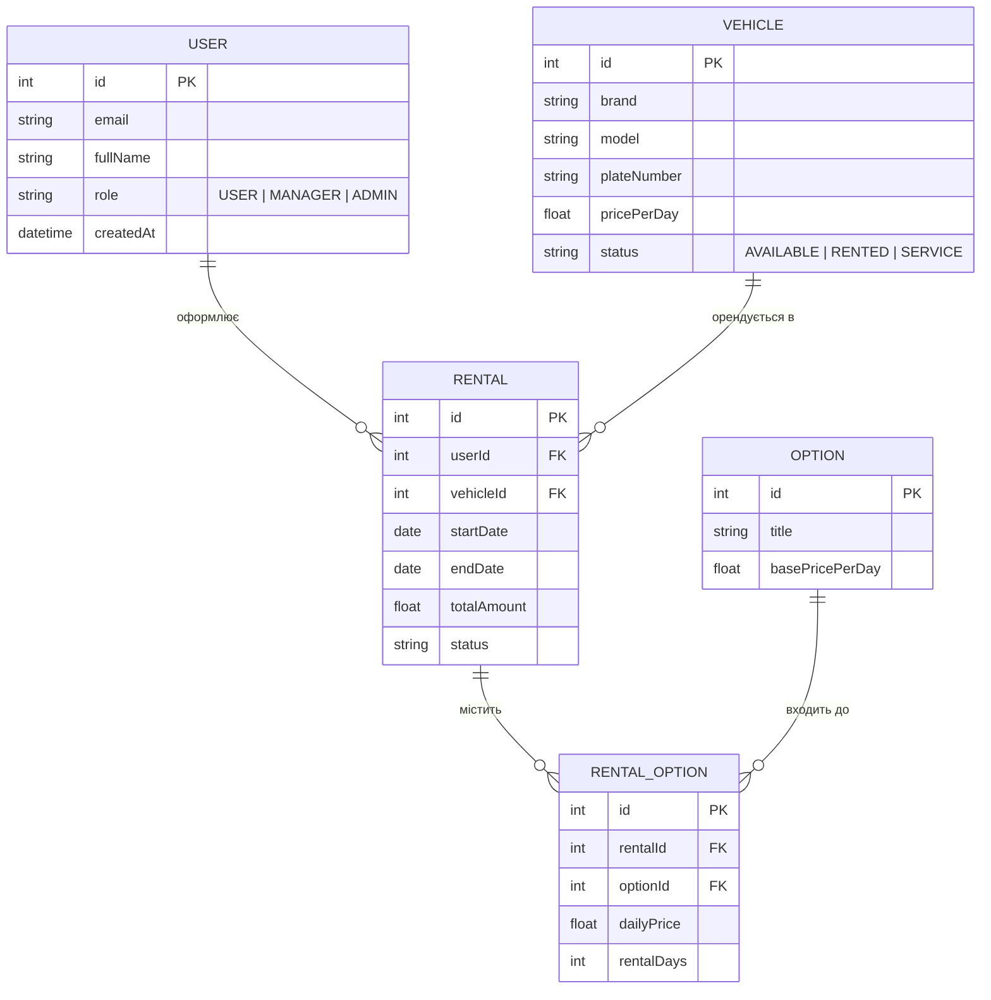

# khntu-web-monolith-dotsenko

Наскрізний проєкт з дисципліни **«Технологія розробки Інтернет-застосунків»** (ХНТУ).
Виконав: Доценко Андрій Юрійович, група 3ЦТ.

## Варіант 4. Сервіс оренди авто та автопарку

Сервіс дозволяє клієнтам орендувати автомобілі з автопарку компанії та додавати до
оренди платні опції (дитяче крісло, GPS-навігатор, повна страховка тощо).

* **User** — користувач системи (орендар, менеджер автопарку або адміністратор).
* **Vehicle** — автомобіль автопарку (марка, модель, номерний знак, ціна за добу, статус).
* **Rental** — оренда: хто, яке авто, з якої по яку дату, загальна вартість, статус.
* **Option** — додаткова опція, яку можна замовити до оренди.
* **RentalOption** — проміжна таблиця зв'язку N:M між Rental та Option
  з власними атрибутами `dailyPrice` (ціна опції за добу на момент оренди) та `rentalDays`.

**Зв'язки:** User 1:N Rental, Vehicle 1:N Rental, Rental N:M Option через RentalOption.

**Ролі:** USER (орендар), MANAGER (менеджер автопарку), ADMIN (головний адміністратор).

## ER-діаграма



## Запуск

```bash
npm install
cp .env.example .env
npm run dev
# GET http://localhost:3000/api/v1/health
```

## REST API (ЛР2, Milestone 1 — мок-дані у пам'яті)

| Метод | Маршрут | Опис |
|---|---|---|
| GET | /api/v1/health | Стан сервера |
| GET | /api/v1/vehicles[?status=AVAILABLE] | Список авто (фільтр за статусом) |
| GET | /api/v1/vehicles/:id | Авто за id (404, якщо нема) |
| POST | /api/v1/vehicles | Додати авто (400 — помилка валідації, 409 — дублікат номера) |
| DELETE | /api/v1/vehicles/:id | Видалити авто (400, якщо воно в оренді) |
| GET | /api/v1/options | Список додаткових опцій |
| GET | /api/v1/options/:id | Опція за id |
| POST | /api/v1/options | Додати опцію |

Колекція Postman: `postman_collection_milestone1.json`.
